<h1 align="center">mograph</h1>

<p align="center"><b>A Claude skill that makes cinematic, music-synced motion-graphics films about technical things.</b><br>Patents, engines, products and pitches, in a crafted isometric look, rendered frame-by-frame to 60 fps MP4.</p>

<p align="center">
  <a href="https://code.claude.com/docs/en/skills"></a>
  <a href="https://agentskills.io"></a>
  <a href="LICENSE"></a>
  <a href="#requirements"></a>
</p>

<p align="center">
  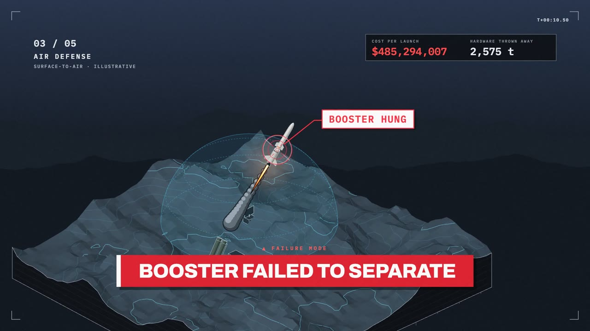
  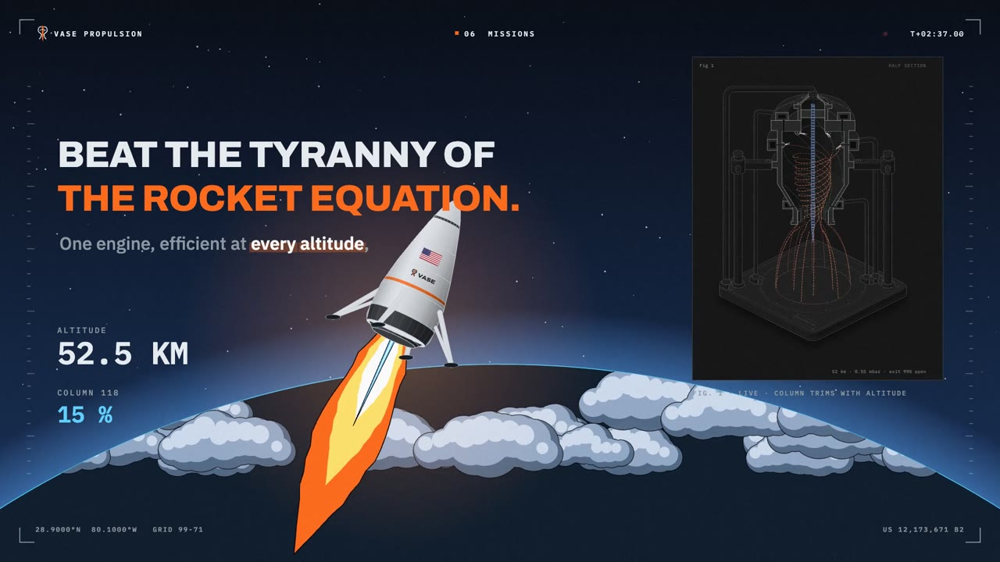
</p>

<p align="center"><sub>From <code>examples/vase-film</code>, a 3-minute investor film for US 12,173,671 B2, made with this skill.</sub></p>

## The film

<p align="center">
  <a href="examples/vase-film/video/VASE-Propulsion-US12173671.mp4">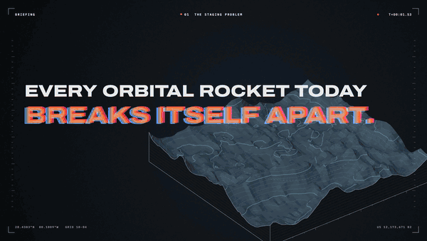</a>
</p>

<p align="center"><sub><a href="examples/vase-film/video/VASE-Propulsion-US12173671.mp4"><b>▶ Watch the film</b></a> the full 3:09 film with sound (the teaser above is 20 s, silent). Every frame was drawn in code with this skill's kit.</sub></p>

---

Ask Claude for an explainer film and mograph has it work like a motion designer. First it finds the truth (the claims, the numbers, the real events with real dates). Next it maps the song you give it: the silences, quiet stretches, drops and kicks. Then it hangs a story on that structure: the shock on the energetic intro, the explanation on the quiet part, the reveal on the drop, the countdown on the breakdown, and the end card held through the final silence.

Every frame is drawn in code by one isometric renderer, so a rocket, a desk lamp and a mountain range all share the same camera and shading. Scenes switch worlds to fit what they show: bright commercial skies, black-ops night vision, dark tactical terrain, paper engineering figures, a warm desk for the founder's story. A headless Chrome seeks the page one frame at a time and pipes it into ffmpeg with a continuous soundtrack and synthesized sound effects.

## Quick start

```sh
npx skills add Atharva2628/mograph -g -a claude-code
```

Or as a Claude Code plugin:

```text
/plugin marketplace add Atharva2628/mograph
/plugin install mograph@mograph
```

Then, in Claude Code:

```text
/mograph make a 90-second investor film for my patent, set to track.mp3
```

## Gallery

<table>
  <tr>
    <td>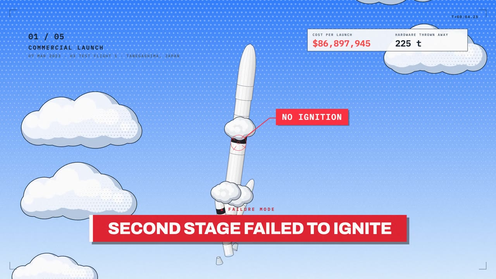</td>
    <td>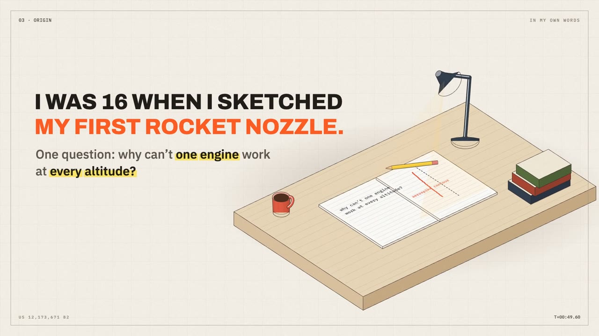</td>
  </tr>
  <tr>
    <td>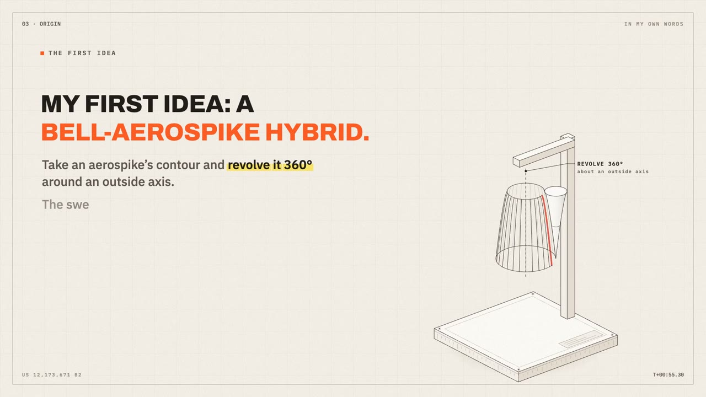</td>
    <td>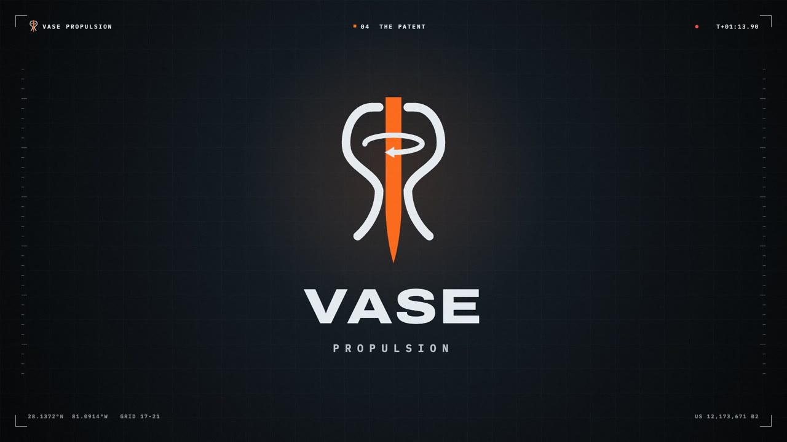</td>
  </tr>
  <tr>
    <td>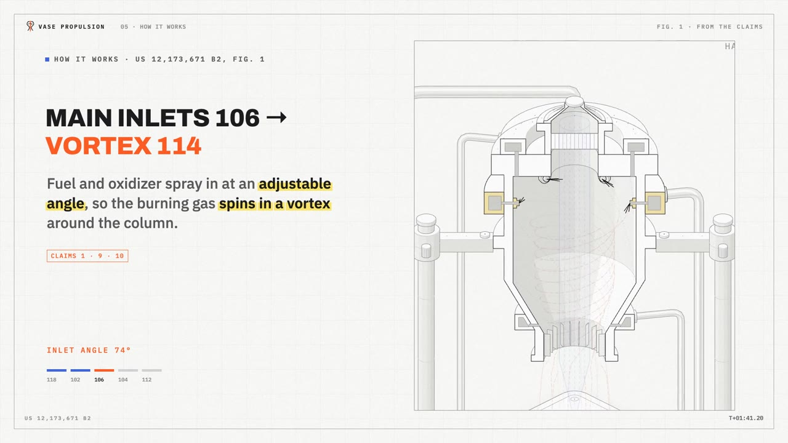</td>
    <td>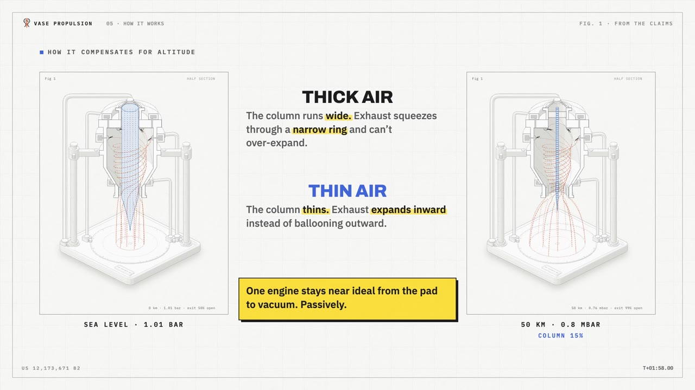</td>
  </tr>
  <tr>
    <td>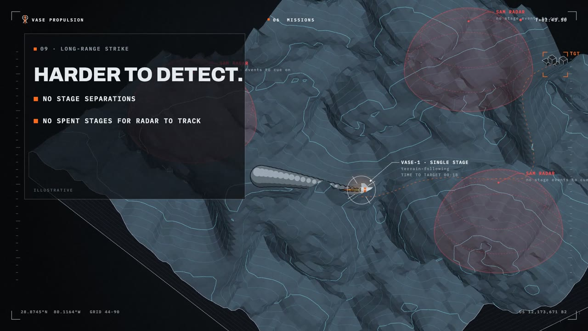</td>
    <td>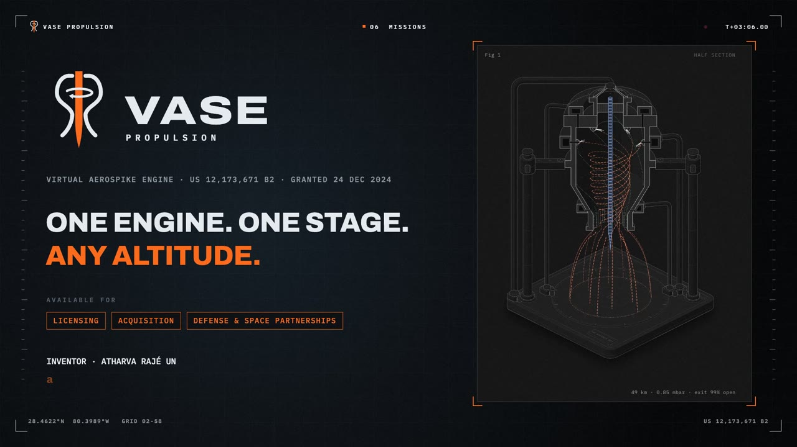</td>
  </tr>
</table>

## What it makes

- **Full films** from 20 seconds to several minutes, 1920×1080 at 60 fps, with a music-only cut alongside.
- **Worlds per scene:** `sky`, `tac`, `nv`, `paper`, `warm` themes with matching HUDs.
- **Dense isometric models:**
  - **Vehicles:** rigid-part vehicles that separate, tumble and land.
  - **Places:** launch complexes, trucks, submarines in cut-away seas, desks and props.
  - **Terrain:** blocks with contour lines and cut-away strata.
- **Effects:** fluffy cel-shaded explosions with halftone and misregistered print layers, cel flames with shock diamonds, smoke trails, impact frames and dot wipes.
- **Words that read:** headlines that pop, narration that types with `*keyword*` highlighting, failure banners and callouts placed where the eye already is.
- **Live figures:** embed your own interactive figure as an iframe, drive its API frame by frame, and zoom into its parts.
- **Sound:** a song map, pitch-kept stretching only across silences, and synthesized effects with ducking. It never chops the music.

## How it works

1. `scripts/analyze_music.py` maps the song.
2. You (Claude) storyboard on that map, budgeting reading time per line.
3. You write one function per scene in `film.js`, using `kit/` (`core.js`, `models.js`, `fx.js`). `kit/host.js` runs the page.
4. `scripts/render.mjs --stills … --sheet` renders contact sheets for review after every act; `scripts/smooth.mjs` checks that flying things don't jitter.
5. `scripts/score.py` builds the soundtrack; `scripts/sfx.py` adds the effects.
6. `scripts/render.mjs --out film.mp4 --audio final.wav` renders the film.

The full method is in [SKILL.md](SKILL.md). The lessons behind it, from five rounds of real feedback, are in [references/lessons.md](references/lessons.md).

## Examples

| Example | What it shows | Runs with |
|---|---|---|
| [`examples/demo`](examples/demo) | 24 s: a hook, a failure shot, an explainer, a silence, a liftoff on the drop, a terrain weave, an end card | nothing: the beat is generated |
| [`examples/vase-film`](examples/vase-film) | the 3:09 VASE Propulsion film, with an embedded live patent figure ([watch it](examples/vase-film/video/VASE-Propulsion-US12173671.mp4)) | your own soundtrack |

```sh
npm install
npm run demo:beat
npm run demo:stills
python3 scripts/score.py --in examples/demo/beat.wav --out examples/demo/score.wav --end 24 --stretch 0:12.2:0.9
python3 scripts/sfx.py --score examples/demo/score.wav --cues examples/demo/cues.json --out examples/demo/final.wav
npm run demo:render
```

## Requirements

- Node 18+ and `npm install` (one dependency: `playwright-core`)
- A Chrome or Chromium (`npx playwright install chromium`, or set `CHROME=/path/to/chrome`)
- ffmpeg on PATH
- Python 3 with `numpy` and `scipy`
- Optional: [Rubber Band](https://breakfastquay.com/rubberband/) (`brew install rubberband`) for clean pitch-kept stretching

## Limits

- The skill can't listen. It verifies levels, joins and durations numerically and asks you to listen through the joins.
- Rendering is real time or slower: a 3-minute film takes 10–20 minutes at 1080p60.
- Models are stylized and isometric. Numbers on screen come from your sources, and anything invented is labelled illustrative.

## License

MIT. The example film's subject matter, brand and patent figure belong to their owner and are included to show the method.
